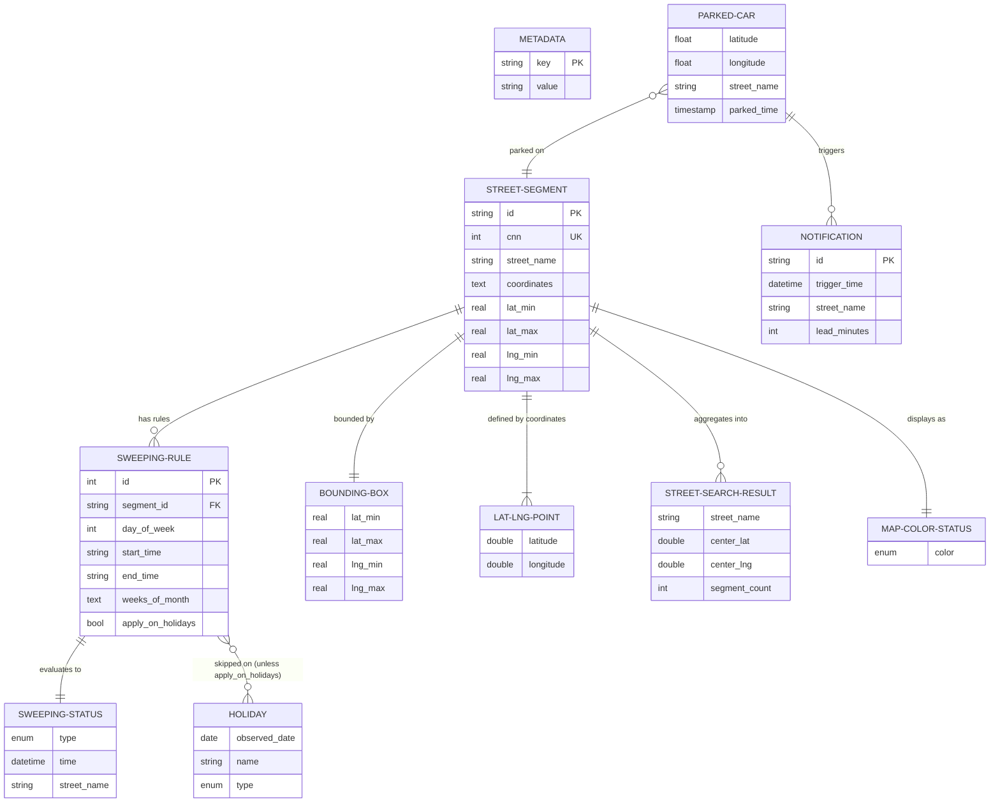
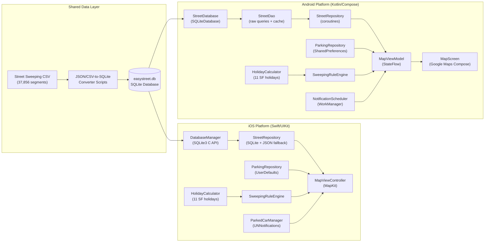

# EasyStreet Data Models & Architecture Diagrams

Generated: 2026-02-09

## Entity-Relationship Diagram

This diagram covers the core data entities across both iOS (Swift/UIKit) and Android (Kotlin/Compose) platforms, plus the shared SQLite database schema.

## System Architecture Flowchart

Shows the layered architecture across both iOS and Android platforms, sharing the same SQLite database format.

## SQLite Database Schema Detail

### `street_segments` Table (iOS)

| Column | Type | Constraint |
|--------|------|------------|
| id | TEXT | PRIMARY KEY |
| street_name | TEXT | NOT NULL |
| coordinates | TEXT | NOT NULL (JSON array of [lat, lng]) |
| lat_min | REAL | NOT NULL |
| lat_max | REAL | NOT NULL |
| lng_min | REAL | NOT NULL |
| lng_max | REAL | NOT NULL |

### `street_segments` Table (Android)

| Column | Type | Constraint |
|--------|------|------------|
| id | INTEGER | PRIMARY KEY AUTOINCREMENT |
| cnn | INTEGER | NOT NULL |
| street_name | TEXT | NOT NULL |
| limits_desc | TEXT | (nullable) |
| block_side | TEXT | (nullable) |
| latitude_min | REAL | NOT NULL |
| latitude_max | REAL | NOT NULL |
| longitude_min | REAL | NOT NULL |
| longitude_max | REAL | NOT NULL |
| coordinates | TEXT | NOT NULL |

### `sweeping_rules` Table (iOS)

| Column | Type | Constraint |
|--------|------|------------|
| id | INTEGER | PRIMARY KEY AUTOINCREMENT |
| segment_id | TEXT | NOT NULL, FK -> street_segments(id) |
| day_of_week | INTEGER | NOT NULL |
| start_time | TEXT | NOT NULL |
| end_time | TEXT | NOT NULL |
| weeks_of_month | TEXT | NOT NULL (JSON array) |
| apply_on_holidays | INTEGER | NOT NULL DEFAULT 0 |

### `sweeping_rules` Table (Android)

| Column | Type | Constraint |
|--------|------|------------|
| id | INTEGER | PRIMARY KEY AUTOINCREMENT |
| segment_id | INTEGER | NOT NULL, FK -> street_segments(id) |
| day_of_week | INTEGER | NOT NULL (1=Mon..7=Sun, java.time) |
| start_time | TEXT | NOT NULL |
| end_time | TEXT | NOT NULL |
| week_of_month | INTEGER | NOT NULL DEFAULT 0 (0=every week) |
| holidays_observed | INTEGER | NOT NULL DEFAULT 0 |

### `metadata` Table (iOS only)

| Column | Type | Constraint |
|--------|------|------------|
| key | TEXT | PRIMARY KEY |
| value | TEXT | NOT NULL |

### Indexes

- `idx_segments_bbox` / `idx_segments_bounds` on bounding box columns (spatial queries)
- `idx_rules_segment` on `segment_id` (rule lookups per segment)

## Platform Schema Differences

| Aspect | iOS | Android |
|--------|-----|---------|
| Segment ID type | TEXT (string) | INTEGER (autoincrement) |
| Extra columns | -- | cnn, limits_desc, block_side |
| Day-of-week convention | 1=Sun..7=Sat (Apple Calendar) | 1=Mon..7=Sun (java.time.DayOfWeek) |
| Weeks encoding | JSON array `[1,3]` | Single integer (0=every) |
| Holiday column name | apply_on_holidays | holidays_observed |
| Bounding box columns | lat_min/lat_max/lng_min/lng_max | latitude_min/latitude_max/longitude_min/longitude_max |
| Metadata table | Yes | No |

## In-Memory Models Summary

### Shared Concepts (Both Platforms)

| Model | iOS (Swift) | Android (Kotlin) | Fields |
|-------|-------------|-------------------|--------|
| Street Segment | `StreetSegment` struct | `StreetSegment` data class | id, streetName, coordinates, rules, bounds |
| Sweeping Rule | `SweepingRule` struct | `SweepingRule` data class | dayOfWeek, startTime, endTime, weeksOfMonth, applyOnHolidays |
| Parked Car | `ParkedCarManager` class | `ParkedCar` data class | latitude, longitude, streetName, timestamp |
| Sweeping Status | `SweepingStatus` enum | `SweepingStatus` sealed class | safe, today, imminent, upcoming, noData, unknown (+activeNow on Android) |
| Holiday Calculator | `HolidayCalculator` class | `HolidayCalculator` object | 11 SF holidays, observed-date shifting, year-based caching |

### Android-Only Models

| Model | Description |
|-------|-------------|
| `LatLngPoint` | Coordinate pair (latitude, longitude) |
| `BoundingBox` | Geographic bounding rectangle (latMin/Max, lngMin/Max) |
| `StreetSearchResult` | Aggregated search result (streetName, center coordinate, segment count) |
